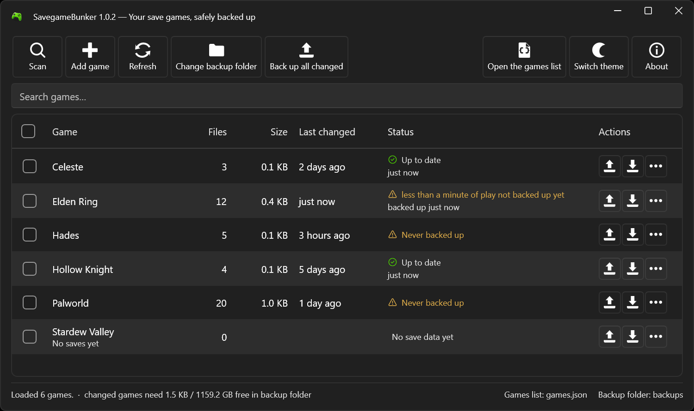

# SavegameBunker

[](https://github.com/ArgusLoom/SavegameBunker/actions/workflows/test.yml)
[](https://github.com/ArgusLoom/SavegameBunker/releases/latest)


[](LICENSE)

**Keep your save games safe — and get them back when you need them.**

Hundreds of hours in a save file deserve better than hoping nothing goes wrong. SavegameBunker copies
your PC game saves to a folder you choose and puts them back with a couple of clicks. One window,
no account, nothing to install.



## Why you'll like it

- 👀 **You see at a glance what needs attention.** Every game shows whether its saves are backed
  up, and how much play you'd lose if they vanished right now.
- 📚 **A curated save-path library is built in.** We hand-check where popular games keep their
  saves and ship that library with the app. One click on **Scan** checks it against your PC and
  offers to add what it finds — ready to back up. Every suggestion is resolved live on your
  machine before it's saved, so a stale entry can't slip through silently. Games outside the
  library you add by hand (see below).
- 💾 **Backing up is one click** — for one game, for the ones you tick, or for everything that
  changed.
- ↩️ **Restoring is safe.** Before SavegameBunker replaces anything, it makes a safety copy of what's
  there now. Changed your mind? Cancel, and nothing happens.
- 🔌 **Your backups go where you want** — a USB stick, an external drive, a network share, or
  simply another folder.
- 🧳 **No installer, no account, no cloud.** It's a single file. Your saves stay yours.

## Get started in a minute

Version 1.0.0 · Windows 11, 64-bit

1. **[Download the latest release](https://github.com/ArgusLoom/SavegameBunker/releases/latest)**,
   unzip it, and run `SavegameBunker.exe`. That's all — no installer and nothing else to download.

   > Windows may show a "Windows protected your PC" notice the first time. That's SmartScreen
   > being cautious about a new app that isn't code-signed; choose **More info → Run anyway**.

2. **Click Scan.** SavegameBunker looks for save folders it recognises on this PC. Tick the games you
   want and click **Add**.

   Game not found? Click **Add game**, type its name and pick its save folder — or just drag the
   save folder onto the window. Not sure where a game keeps its saves? The globe button in that
   dialog looks it up on PCGamingWiki for you.

3. **Click Back up all changed.** The first time, SavegameBunker asks where your backups should live
   and remembers the answer.

That's it — your saves are safe. 🎉

## Reading the list

The **Status** column tells you where each game stands:

| You see | What it means |
|---|---|
| ✅ **Up to date** | Your newest backup already has your latest saves. Nothing to do. |
| ⚠️ **3 hours of play not backed up yet** | You've played since the last backup. A good moment to back up. |
| ⚠️ **Never backed up** | This game has saves but no backup at all yet. |
| **No save data yet** | There's nothing in the save folder right now — maybe you haven't played yet. |
| **Backup folder unavailable** | SavegameBunker can't reach your backup folder. Is the drive plugged in? |

Hover over any button to see what it does.

## Backing up

- **One game:** click the **Back up** arrow on its row.
- **Everything that changed:** click **Back up all changed**.
- **Just the ones you pick:** tick their boxes and click **Back up selected** — the button shows
  how many are ticked.

Have a long list? Type in the search box to narrow it down. Your ticks stay put while you search.

**One tip:** close the game before you back it up, so it isn't in the middle of writing a save.

## Getting your saves back

Click the **Restore** arrow on a game's row and pick the backup you want — each one is listed
with its date and time. Then SavegameBunker:

1. makes a safety copy of your current saves,
2. asks you to confirm — and warns you if your current saves are *newer* than the backup you
   picked,
3. swaps the backup in.

If you choose **Cancel**, nothing changes at all.

Restoring several games? Tick them and click **Restore selected**. Each game gets its newest
backup, and SavegameBunker asks about every game separately, so nothing is replaced without your OK.

**Moving to a new PC?** Bring `SavegameBunker.exe`, its `games.json` and your backup folder along,
then restore. One honest caveat: some games tie their saves to a particular Steam account or
machine. SavegameBunker always puts the files back faithfully, but it can't make a game accept them.

## Good to know

- **SavegameBunker backs up when you tell it to.** There's no automatic backup. If games have
  changes not backed up yet, it asks once at startup; otherwise a quick click on **Back up all
  changed** after a play session does the job.
- **For real peace of mind, back up to a different drive.** A backup on the same disk as your
  saves protects you from accidents and bad patches, but not from that disk failing.
- **Removing a game from the list deletes nothing.** Your saves and backups stay where they are.
- **The built-in game list is hand-maintained, small and never fetched.** It ships as a fixed snapshot inside
  `SavegameBunker.exe` — there is no online update, so newly released
  games and games that move their save folder are simply not in it until the next release. Scan
  finds only what that table knows; every other game needs **Add game** and its save folder typed
  (or dragged) in by hand. If a table entry looks off, open the **⋯** menu on that row and choose
  **Change save folder**.
- **It only does saves.** SavegameBunker isn't a launcher and isn't cloud sync. It copies the folders
  you point it at, and nothing else.
- **Got a games list or backups from someone else?** Treat them like any other file from a
  stranger. SavegameBunker never runs programs from them — but it will restore whatever you pick.

## Keyboard shortcuts

| Keys | What happens |
|---|---|
| **Ctrl+B** | Back up the focused row |
| **Ctrl+R** | Restore the focused row |
| **Alt**, then the underlined letter | Press any toolbar button |

Everything stays readable at Windows text sizes up to 150%. SavegameBunker starts light or dark,
like Windows; **Switch theme** flips it for the current session.

## Want more detail?

The [user guide](https://argusloom.github.io/SavegameBunker/) walks through every task step by
step — in [English](https://argusloom.github.io/SavegameBunker/en/) and in
[German](https://argusloom.github.io/SavegameBunker/de/). The same guide ships inside the download
and opens offline from the **Help** button.

## For the curious

<details>
<summary>Where SavegameBunker keeps its settings</summary>

Everything — your games and your backup folder — lives in one small file, `games.json`, right
next to `SavegameBunker.exe`. The app edits it for you. You can edit it by hand too
(**Open the games list** opens it), though comments in the file don't survive the next change
made from the app.

```json
{
  "backupRoot": "SavegameBunkerBackups",
  "games": [
    {
      "id": "witcher3",
      "displayName": "The Witcher 3: Wild Hunt",
      "saveDirTemplate": "%DOCUMENTS%/The Witcher 3/gamesaves"
    }
  ]
}
```

Save folders can use `%DOCUMENTS%`, `%SAVEDGAMES%`, `%APPDATA%`, `%LOCALAPPDATA%` and
`%USERPROFILE%`, and forward slashes work everywhere.

**Portable setup:** start SavegameBunker with another list — `SavegameBunker.exe D:\retro-games.json` — and
a relative `backupRoot` is looked up next to that file. Put the exe, the list and the backups on
one USB stick, and it works on any PC, whatever drive letter Windows gives it.

</details>

<details>
<summary>Building from source</summary>

You need the .NET 10 SDK. Two NuGet packages restore with the build: WPF-UI 4.3.0 and
CommunityToolkit.Mvvm 8.4.2. `dotnet build` works on Windows, Linux and macOS; running the app
and the test suite needs Windows.

```powershell
dotnet build SavegameBunker.sln
dotnet test SavegameBunker.sln
dotnet run --project src/SavegameBunker
```

The single-file publish command is in [Releasing](#releasing) — the release zip CI builds is
~63 MB, the single-file exe being its dominant member, and the exe runs without the SDK or a
.NET runtime.

### Releasing

Releases are built by CI ([`release.yml`](.github/workflows/release.yml)) when a `v*` tag is
pushed. Before pushing the tag:

- make sure the test suite is green. [`test.yml`](.github/workflows/test.yml) runs it on
  `windows-latest` for every pull request (and on demand from the Actions tab), and the release
  workflow runs it again and stops if it fails. Plain pushes to `main` are not tested;
- confirm the CHANGELOG has a `## [<Version>] - YYYY-MM-DD` section (it becomes the release
  notes) and the csproj `<Version>` matches the tag.

CI first runs the full test suite on `windows-latest` and stops if it fails. It then publishes the
single-file exe, builds the user guide (en + de) into `help/`, zips it with a
SHA-256 sidecar, and creates the GitHub release.

To publish the single-file build locally instead, keep the version-matching flags the workflow
uses on Linux:

```powershell
dotnet publish src/SavegameBunker/SavegameBunker.csproj -c Release -p:PublishSingleFile=true -p:EnableCompressionInSingleFile=true -p:EnableWindowsTargeting=true -p:DebugType=none -p:DebugSymbols=false -o publish
```

</details>

## License

[MIT](LICENSE) — free to use, share and change.
