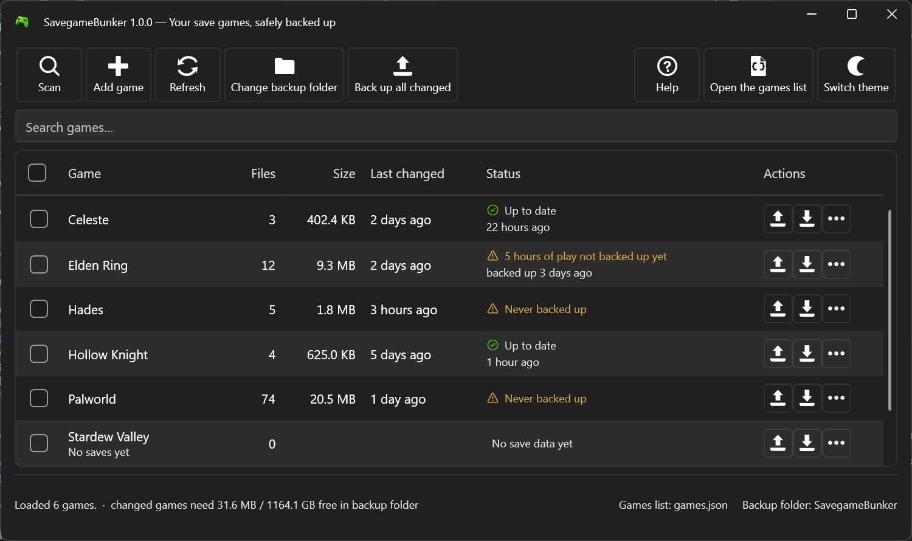

# SavegameBunker

Sichert Spielstände von PC-Spielen in einem Ordner Ihrer Wahl und spielt sie zurück.
Ein Fenster, kein Konto, nichts installiert.

SavegameBunker ist eine kleine Windows-App mit genau einer Aufgabe: Ihre Spielstand-Ordner an einen
sicheren Ort kopieren und bei Bedarf zurückkopieren. Die App startet keine Spiele, synchronisiert
nicht mit einer Cloud und überwacht nicht laufend Ihre Festplatte. Sie entscheiden, wann eine
Sicherung stattfindet.

!!! note "Die Benutzeroberfläche ist englisch"
    SavegameBunker hat keine deutsche Übersetzung. Diese Anleitung ist auf Deutsch, nennt aber jede
    Schaltfläche und jeden Menüpunkt genau mit dem englischen Text, der tatsächlich im Programm
    steht — fett markiert, z. B. **Add game**.

## Wo Sie anfangen

- Neu bei SavegameBunker? Lesen Sie [Erste Schritte](getting-started.md).
- Sie suchen eine bestimmte Aufgabe? Die Anleitungen in der Seitenleiste behandeln Sichern,
  Wiederherstellen, ein Spiel hinzufügen oder den Sicherungsordner wählen, sowie den Umzug auf
  einen neuen PC.
- Sie brauchen das genaue Dateiformat oder alle Tastenkombinationen? Siehe den Referenzbereich.
- Neugierig, was SavegameBunker bewusst **nicht** tut? Siehe
  [Was SavegameBunker nicht tut](reference/limitations.md).

## Voraussetzungen

Windows 11, 64-Bit. Die App ist eine einzelne, eigenständige `.exe`-Datei — kein Installer, keine
separat zu installierende .NET-Laufzeit. Windows zeigt beim ersten Start möglicherweise eine
SmartScreen-Warnung — das liegt an der unsignierten Build und ist kein Hinweis auf eine fehlende
Abhängigkeit.
