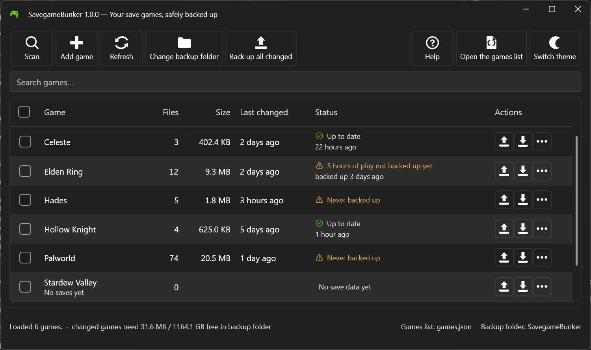

# SavegameBunker

Back up PC game saves to a folder you choose, and put them back.
One window, no account, nothing installed.

SavegameBunker is a small Windows app that does one job: copy your game save folders somewhere safe,
and copy them back when you need to. It does not launch games, sync to the cloud, or watch your
disk for changes. You decide when a backup happens.

!!! note "Names in this guide match the app"
    This guide refers to every button and menu item exactly by the text it carries in the
    program — bolded, e.g. **Add game**.

## Where to start

- New to SavegameBunker? Read [Getting started](getting-started.md).
- Looking for a specific task? See the how-to guides in the sidebar — back up, restore, add a
  game, change the backup folder, or move to a new PC.
- Want the exact file format or every keyboard shortcut? See the reference section.
- Curious what SavegameBunker deliberately does **not** do? See
  [What SavegameBunker doesn't do](reference/limitations.md).

## Requirements

Windows 11, 64-bit. The app is a single self-contained `.exe` — no installer, no .NET runtime to
install separately. Windows may show a SmartScreen warning on first run because the build is
unsigned; that is not a sign of a missing dependency.
